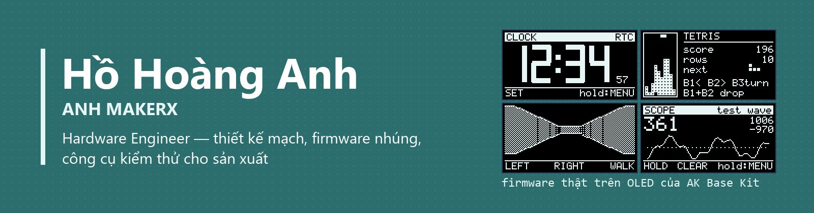

  

  <a href="https://hohoanganh.github.io/ak-mcu-base/play/"><b>Chạy thử firmware trên trình duyệt</b></a> ·
  <a href="https://github.com/hohoanganh/ak-mcu-base">ak-mcu-base</a> ·
  <a href="https://www.tiktok.com/@hohoanganh1">TikTok</a>

## Giới thiệu

Tôi là **Hồ Hoàng Anh**, kỹ sư phần cứng. Tôi thiết kế mạch điện tử, viết firmware cho vi điều khiển và làm công cụ
kiểm thử cho sản xuất. Trang này là những thứ tôi làm ngoài giờ, chủ yếu quanh firmware nhúng.

| Mảng | Công việc |
|---|---|
| **Phần cứng** | Schematic, PCB, đưa board từ bản vẽ tới sản xuất |
| **Firmware** | STM32, ESP32, nRF52; Modbus RTU, bootloader, OTA |
| **Công cụ** | Tool test và nạp firmware cho dây chuyền, viết bằng Python |

## Dự án nổi bật

### [ak-mcu-base](https://github.com/hohoanganh/ak-mcu-base): nền firmware cho STM32L151

Nền firmware bare-metal dựng lại từ [AK Base Kit](https://github.com/the-ak-foundation/ak-base-kit-stm32l151) của
AK Foundation: kernel hướng sự kiện không cần RTOS, bootloader có quay lui, cập nhật firmware qua UART và RS485.

- **Chạy thử:** [17 màn hình của kit](https://hohoanganh.github.io/ak-mcu-base/play/) trong trình duyệt, không cần kit
- **Xem bên trong:** [dừng firmware, chạy từng message](https://hohoanganh.github.io/ak-mcu-base/play/inside.html)
- **Lập trình kéo thả:** [nối khối, bấm Chạy](https://hohoanganh.github.io/ak-mcu-base/play/blocks.html)
- **Demo có gì:** [từng màn hình, kèm ảnh động](https://github.com/hohoanganh/ak-mcu-base/blob/main/docs/demo-kit.md)
- **Tải firmware:** [Releases](https://github.com/hohoanganh/ak-mcu-base/releases)

 

Vài điểm đáng xem:

- **Một mã nguồn, ba nơi chạy.** Cùng mã C chạy trên chip, trong unit test trên máy tính và trong trình duyệt
  (WebAssembly), vì ranh giới với bo mạch được giữ thật mỏng.
- **Firmware tự kể lại sự cố.** HardFault, FATAL, watchdog và task treo được ghi vào EEPROM, báo lại ở lần khởi động sau.
- **Bootloader chịu được mất điện.** Unit test giả lập cắt điện ở 1366 điểm trong lúc cài; lần nào cũng khôi phục được.
- **Ảnh trong tài liệu không phải ảnh chụp.** Chúng được dựng từ chính mã vẽ của firmware, nên không lệch với thực tế.

## Cộng đồng

Các dự án ở đây đứng trên nền của [AK Foundation](https://github.com/the-ak-foundation), nhóm làm phần mềm nhúng tại
Việt Nam. Nếu bạn mới học lập trình hướng sự kiện cho vi điều khiển, hãy bắt đầu từ
[chương trình đào tạo](https://github.com/the-ak-foundation/embedded-training-program) của họ.

## Liên hệ

- Góp ý hoặc báo lỗi: mở issue ở dự án tương ứng, ví dụ [ak-mcu-base](https://github.com/hohoanganh/ak-mcu-base/issues).
- TikTok: [@hohoanganh1](https://www.tiktok.com/@hohoanganh1)

  

